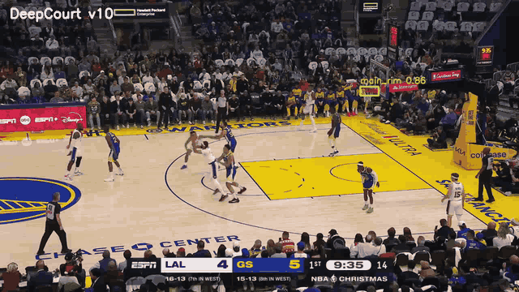
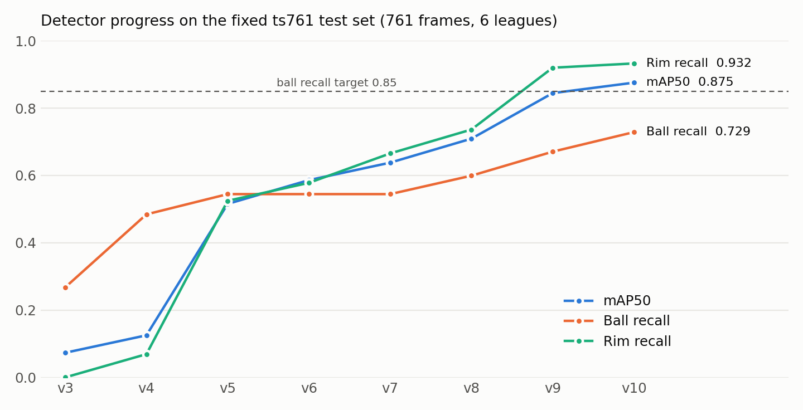

# DeepCourt — Basketball Video Analysis with Computer Vision

DeepCourt turns raw basketball game footage into structured data: it detects the ball and rim, tracks players, reads jersey numbers, and builds per-player stats, play-by-play, and coaching insights on top of that. On top of the analysis sits a small social layer where players create profiles, join teams, and link themselves to the players detected in their games.



*The v10 detector running on broadcast footage: it detects the ball mid-shot and locks onto the active rim.*

## Highlights

- **Custom ball and rim detector (YOLO11s, 3 classes)**, trained over 10 iterations with a failure-mining loop. Each version runs on real games, its misses get collected and labeled by hand, and the next version trains on them.
- **13,282 training frames** from 6 leagues (NCAA, NBA, EuroLeague, FIBA, CBA, Olympics), plus a separate 2,344-frame validation set.
- **A fixed benchmark that never enters training.** Every version is scored on the same 761-frame test set, so the numbers below are directly comparable.
- **Full pipeline from video to stats:** detection, pose, multi-object tracking, jersey OCR, re-identification, team classification, court homography, event logic, narrative, and feeds.

## Results



| Version | mAP50 | mAP50-95 | Ball recall | Ball precision | Rim recall |
|---|---|---|---|---|---|
| v3 | 0.074 | 0.025 | 0.27 | 0.23 | 0.00 |
| v4 | 0.126 | 0.052 | 0.48 | 0.14 | 0.07 |
| v5 | 0.516 | 0.290 | 0.55 | 0.58 | 0.53 |
| v6 | 0.586 | 0.371 | 0.55 | 0.70 | 0.58 |
| v7 | 0.638 | 0.430 | 0.55 | 0.76 | 0.67 |
| v8 | 0.709 | 0.514 | 0.60 | 0.78 | 0.74 |
| v9 | 0.844 | 0.537 | 0.67 | 0.88 | 0.92 |
| **v10** | **0.875** | **0.583** | **0.73** | **0.91** | **0.93** |

Every score above comes from the fixed ts761 test set at `imgsz=1280`. The full comparison of all 16 checkpoints, including early experiments and per-class numbers, is in [docs/benchmarks](docs/benchmarks/ts761_model_comparison.md).

**What I learned along the way:**

- **Validation scores overstated how good the model was.** v9 scored 0.88 ball recall on its own validation set but only 0.67 on the held-out benchmark. The validation set shared too much with training (adjacent frames, same games). Since then, versions are compared only on the fixed test set.
- **The ball is the hard part.** The rim is solved for practical purposes (0.93 recall). The ball is small, blurry in flight, and often hidden by hands, so ball recall (0.73) is still the bottleneck, against a target of 0.85.
- **Bigger input beat a bigger model.** Going from 640 to 1280 px input (v4 → v5) gave the largest single jump, because the ball often takes up only a few pixels.

## Training lineage

| Version | Base | Input | Dataset | Notes |
|---|---|---|---|---|
| v3 | YOLO11n (COCO) | 640 | — | First 3-class model (ball / main_rim / other_rim) |
| v4 | YOLO11s (COCO) | 640 | — | Larger backbone |
| v5 | v4 | 1280 | 8.1k frames | Higher input resolution |
| v6 | v5 | 1280 | 8.9k frames | Added mined failure frames |
| v7 | v6 | 1280 | 10.8k frames | Lower learning rate (5e-4) for fine-tuning |
| v8 | v7 | 1280 | — | Continued fine-tuning |
| v9 | v8 | 1280 | — | lr 3e-4 |
| v10 | v9 | 1280 | 13.3k train / 2.3k valid | +1,000 hard frames mined from v9 on NBA / EuroLeague / Olympics footage |

Training ran on a rented A40 GPU (RunPod). See [tools/train_v10.py](tools/train_v10.py).

## Architecture

```
video ──► detection ──► tracking ──► identity ──► court mapping ──► events ──► stats & feeds
          YOLO11 ball/rim  ByteTrack    jersey OCR     homography        rule-based    box score
          YOLO-Pose        (supervision) ResNet50 re-ID (hoop anchors)   validator     play-by-play
          HSV fallback                  hue k-means teams                            learning moments
```

| Layer | Components |
|---|---|
| Vision ([src/vision](src/vision)) | Custom YOLO11 detector, YOLO-Pose keypoints, ByteTrack, EasyOCR jersey reading, ResNet50 re-ID embeddings, court homography |
| Logic ([src/logic](src/logic)) | Event validation (assist window, steals, rebounds), box score math, pattern detection across mistakes |
| Narrative ([src/narrative](src/narrative)) | Play-by-play text generated from structured events |
| Social ([src/social](src/social)) | Game, Plays, and Learning feeds |
| App ([dashboard](dashboard), [landing](landing)) | Streamlit product UI, FastAPI auth (Google OAuth + bcrypt), landing page |

Every logged event carries a machine-readable `reason` field, for example `"Pass-to-score gap = 2.1s, dribble count = 0"`, so each stat can be traced back to the evidence behind it.

## Tooling for the data loop

| Script | Purpose |
|---|---|
| [tools/mine_v10_failures.py](tools/mine_v10_failures.py) | Run a model on real games and collect the frames it got wrong |
| [tools/local_yolo_labeler.py](tools/local_yolo_labeler.py) | Desktop GUI for labeling ball and rim boxes |
| [tools/mine_test_set.py](tools/mine_test_set.py) | Build a diverse, fixed test set across leagues |
| [tools/resplit_dataset.py](tools/resplit_dataset.py) | Re-split train/valid without leaking the test set |
| [tools/benchmark_ts761.py](tools/benchmark_ts761.py) | Score any set of checkpoints on the fixed benchmark |
| [tools/sliced_ball_inference.py](tools/sliced_ball_inference.py) | Tiled inference for tiny, distant balls |

## Project status

- **Detection** is the active focus, since every stat depends on knowing where the ball and rim are.
- **The stats layer** (points, assists, rebounds, narrative) is built but experimental. It's paused until ball detection passes its quality bar (see [DETECTION_CORE.md](DETECTION_CORE.md)). Only the detection-side tests are included here.

## Running it

```bash
python -m venv .venv && source .venv/bin/activate
pip install -r requirements.txt
pytest tests
./start.sh            # API on :8510, dashboard on :8502
```

Model weights and training data are not included in this repository. Without the custom weights, ball detection falls back to the COCO `sports_ball` class of the public YOLO11 model plus an HSV color detector, which is much less accurate.

## Tech stack

Python · PyTorch · Ultralytics YOLO11 · supervision (ByteTrack) · EasyOCR · OpenCV · FastAPI · Streamlit · SQLite

---

Demo footage is from a publicly broadcast NBA game and is used here only to demonstrate the model.
